

# GoMule, extended

**A [GoMule](https://github.com/silospen/gomule) fork for D2R 3.4: dark theme, shared stash auto-sort, roll columns, smarter search.**

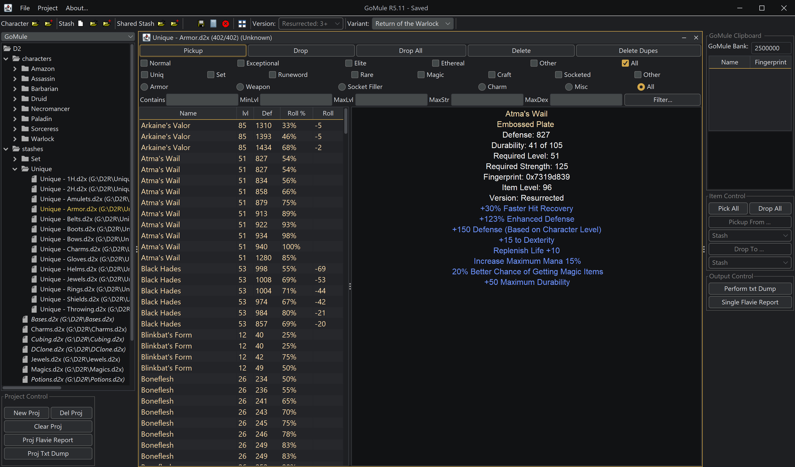

> [!NOTE]
> Only the fork's additions are listed here. Original notes: [`GoMule/README.txt`](GoMule/README.txt).

## Modern dark theme

- New default look, with gold accents and striped tables. Switch under **File > Switch Appearance**.
- Open files show in gold in the project tree.

## Shared stash auto-sort

<table>
<tr>
<td width="42%" valign="top">

**1. Rules:** right-click an ATMA stash, then **Sorting rules...**. An item must match every section you fill in.

</td>
<td>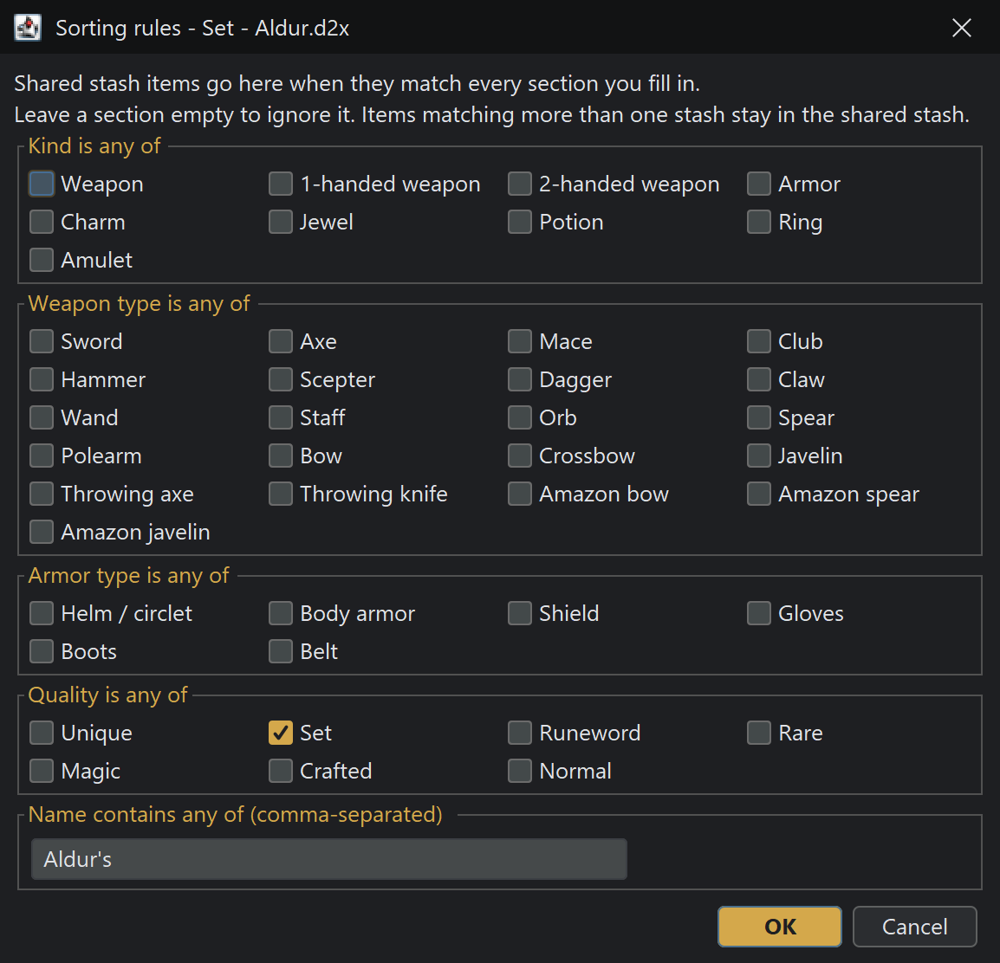</td>
</tr>
<tr>
<td valign="top">

**2. Sort:** press **Sort into ATMA stashes**.

</td>
<td>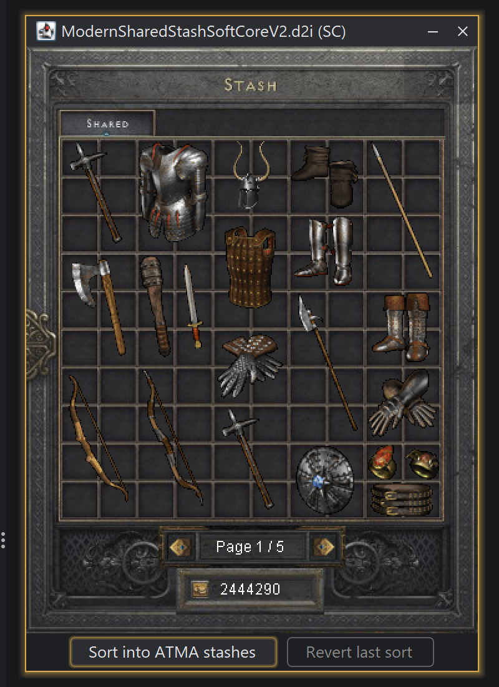</td>
</tr>
<tr>
<td valign="top">

**3. Preview:** confirm before anything moves. Items that match no stash, or more than one, stay put.

**4. Undo:** **Revert last sort** works until you save.

</td>
<td>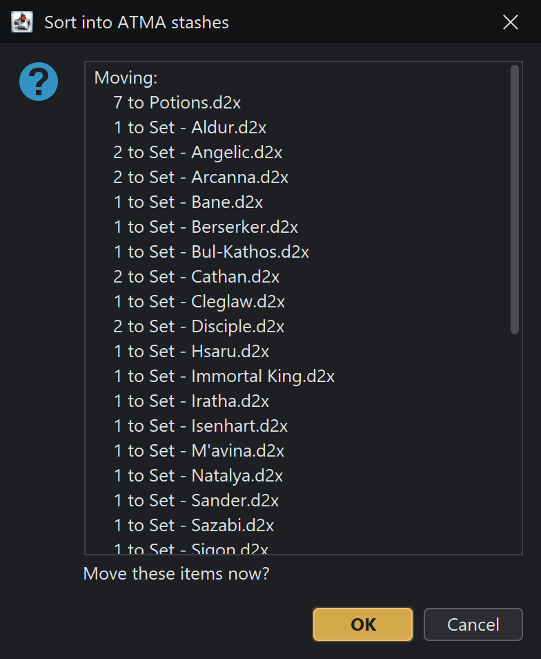</td>
</tr>
</table>

You can also drag a shared stash item onto an ATMA stash in the tree.

## Roll columns

| Column | Meaning | Example |
|---|---|---|
| **Roll %** | Average roll of all varying stats (uniques, sets, runewords) | `89%` |
| **Roll** | Points short of perfect, defense excluded | Annihilus 16/20, 5/10% → `-9` |

Sorting breaks ties by name, then worst roll, then lowest defense. Duplicates line up worst to best.

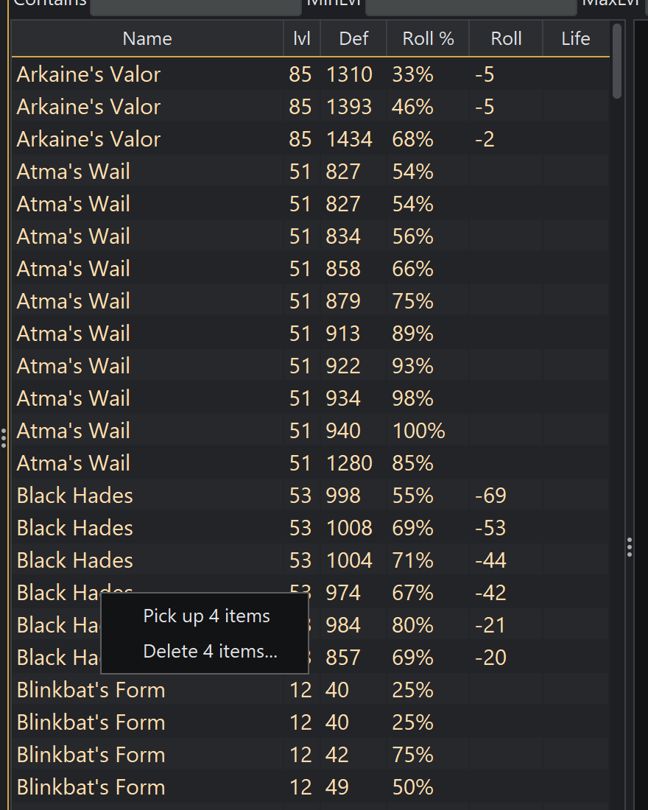

## Custom columns

- Each stash (and the All view) keeps its own columns.
- Right-click a header to hide it or **Choose columns...**.
- Add built-in columns (ilvl, Rarity, Base, Sock, Def, Eth, Set, Roll, From...) or any property, such as `to Life`.
- Click a header to sort.

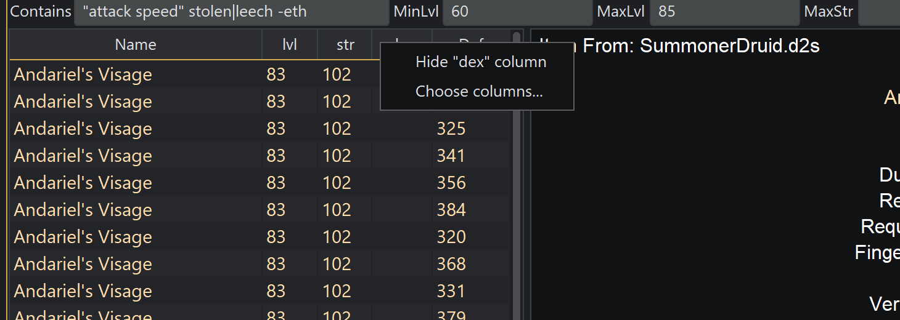
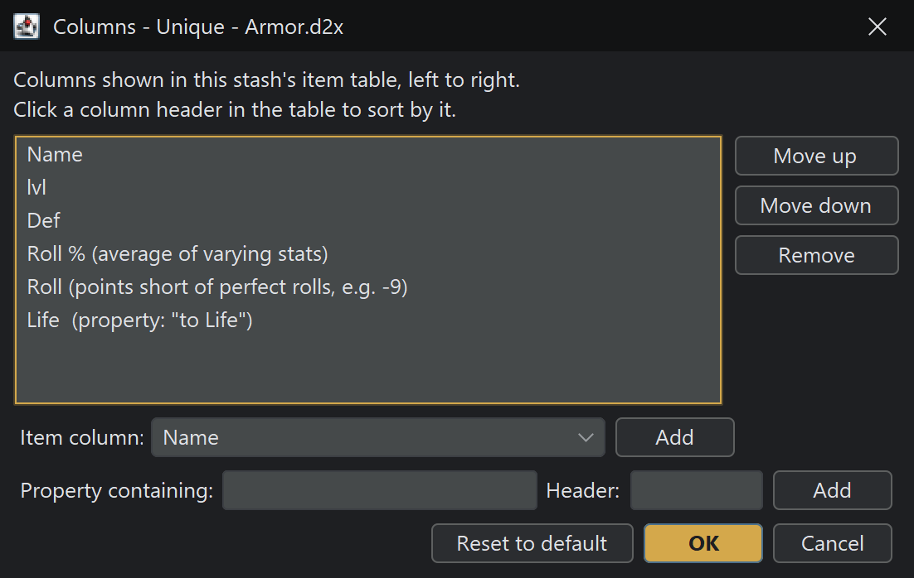

## Smart search

| Query | Finds |
|---|---|
| `ias res` | all words |
| `-eth` | without the word |
| `jah\|ber` | either word |
| `"cast rate"` | exact phrase |

- New **MinLvl** box, next to MaxLvl.
- **Filter...** now matches text literally.

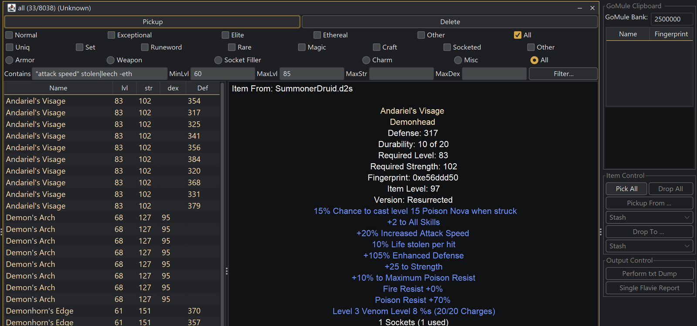

## Tree folders and the All view

<table>
<tr>
<td valign="top">

- Right-click a section or folder to add, rename or delete folders. Folders can nest.
- **Move to folder** files a character or stash.
- Untick **Show in All**, per stash or per folder, to hide it from All. Hidden stashes show in *italics*.

</td>
<td width="38%">
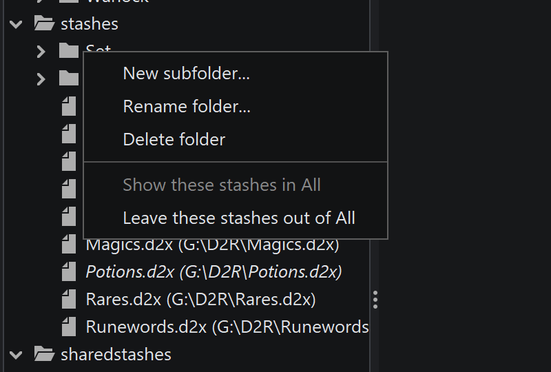
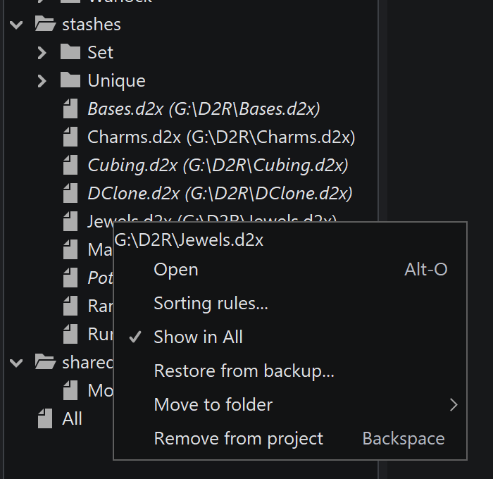
</td>
</tr>
</table>

## Delete items

Use **Delete**, the <kbd>Delete</kbd> key or right-click on one or more items. It always asks first, and can be turned off per project.

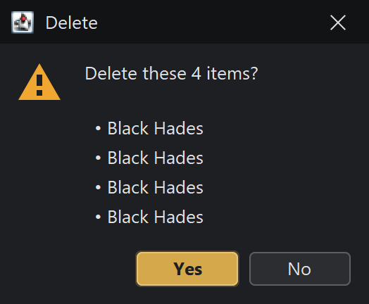

## Restore from backup

Each save keeps the last 3 versions as `.bak` files. Right-click a stash, then **Restore from backup...**. A restore can itself be undone.

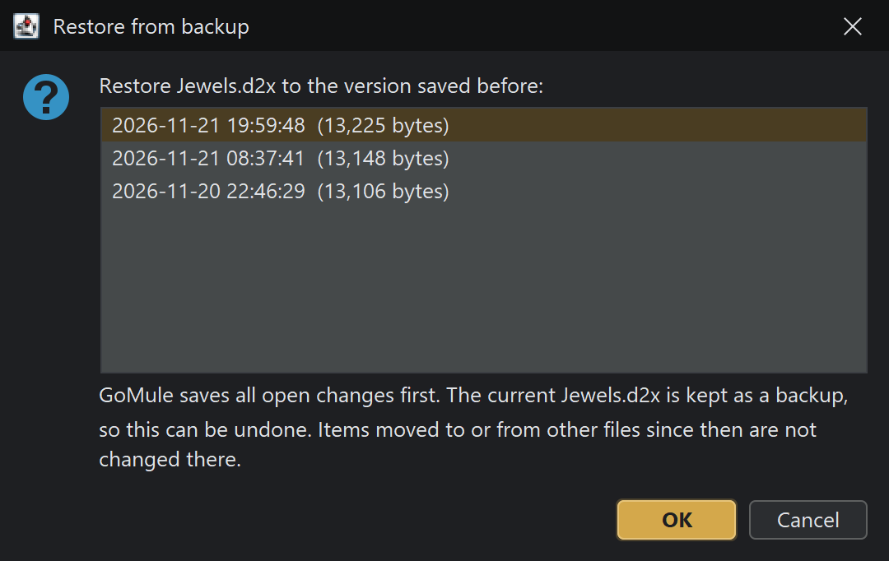

## Fixes

- Loads D2RLoader / newer 3.4 saves (128-bit IDs on misc items).
- No 2.5M cap when moving gold from the shared stash to the bank.
- Shared stash shows total gold across all pages.
